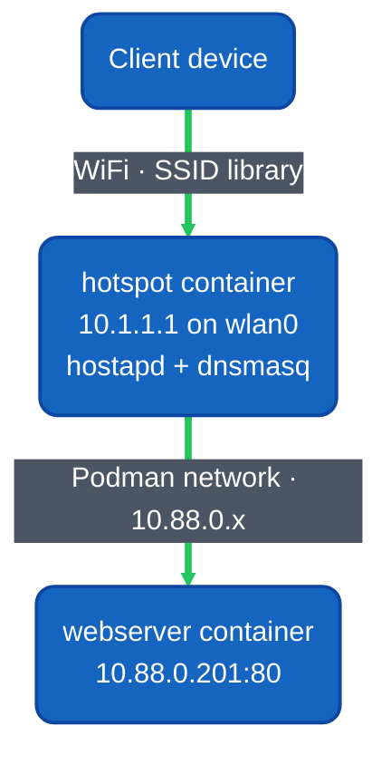

# Hotspot Container

The hotspot container creates a WiFi access point so users can connect directly to the Library system without an existing network. It broadcasts SSID `library` (open, no password) and provides DHCP/DNS so clients can reach the library webserver at `http://library` or `http://library.local`.

## File Structure

```
hotspot/
├── Containerfile    # Container build instructions
├── hotspot.py       # Main script (brings up wlan0, starts hostapd + dnsmasq)
├── hotspot          # Shell wrapper script (runs hotspot.py)
└── README.md
```

## Building the Container

Build with the default `localhost/rasbase_master:latest` base (Debian 13 Trixie,
ARM64). Use the appliance's rootful Podman image store:

```bash
sudo podman build -t localhost/hotspot:latest -f Containerfile .
```

The parent [`build_pods.sh`](../build_pods.sh) builds this image along with the
other Library services, including both radio images. See the
[build and export workflow](../../../../docs/DEVELOPERS.md#container-build-pipeline)
for preparing the base image and offline tar files. Run the Podman commands below
as root, or prefix them with `sudo`.

## Running the Container

The hotspot container requires host network access and the wlan0 device:

```bash
podman run -d \
    --name hotspot \
    --network=host \
    --privileged \
    --cap-add=NET_ADMIN \
    --cap-add=NET_RAW \
    localhost/hotspot:latest
```

- **--network=host**: Required for direct access to the host's WiFi hardware
- **--privileged**: Required for interface manipulation and hostapd
- **--cap-add=NET_ADMIN**: Allows network interface configuration
- **--cap-add=NET_RAW**: Allows raw socket access for DHCP

## How It Works

1. **wlan0 up** — Brings the wireless interface online
2. **Static IP** — Assigns 10.1.1.1/24 to wlan0 (this becomes the gateway)
3. **hostapd** — Broadcasts SSID `library` on channel 7 (2.4 GHz, open network)
4. **dnsmasq** — Provides DHCP (10.1.1.10–10.1.1.100) and DNS resolution

## Configuration

All configuration is embedded in `hotspot.py`. Key settings:

### WiFi (hostapd)

| Setting | Value | Description |
|---------|-------|-------------|
| SSID | `library` | Network name clients see |
| Channel | 7 | 2.4 GHz WiFi channel |
| Driver | nl80211 | Standard Linux wireless driver |
| Auth | Open | No password required |

### DHCP/DNS (dnsmasq)

| Setting | Value | Description |
|---------|-------|-------------|
| DHCP range | 10.1.1.10 – 10.1.1.100 | Up to 91 simultaneous clients |
| Lease time | 24h | How long a client keeps its IP |
| DNS server | 10.1.1.1 | Pushed to clients (this host) |
| DNS: `library` | → 10.1.1.1 | Resolves to the webserver |
| DNS: `library.local` | → 10.1.1.1 | Alternate name for webserver |

### Network

| Address | Purpose |
|---------|---------|
| 10.1.1.1/24 | Hotspot gateway / DNS server |
| 10.1.1.10–100 | DHCP client range |

## Troubleshooting

- **"Failed to start wlan0"** — Ensure the container has access to the WiFi device. You may need `--privileged` or explicit `--device` flags.
- **No SSID visible** — Check that no other process (like NetworkManager) is controlling wlan0 on the host. Stop it with `systemctl stop NetworkManager` before starting the container.
- **Clients can't resolve `library`** — Verify dnsmasq is running inside the container with `podman exec hotspot ps aux | grep dnsmasq`.

## Network Diagram


